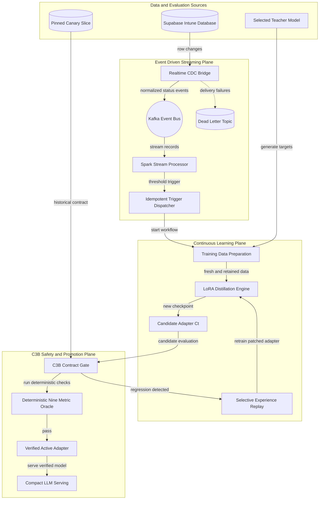
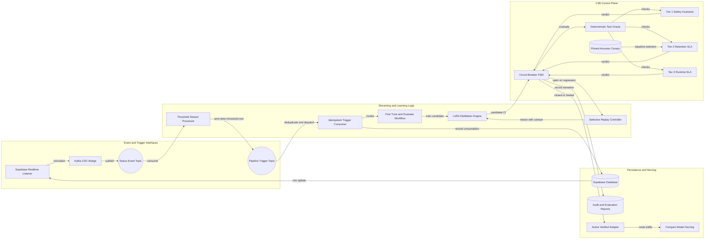

# Architecture Diagram

This high-level view presents INTUNE as an event-driven system for continuous knowledge distillation. The central safety mechanism is the C3B circuit breaker, which gates candidate adapters with deterministic behavioral contracts and initiates selective replay when a regression is detected.

## Application Architecture

<!-- mermaid-checked: no \n, no em-dash/en-dash, no {} in labels, subgraphs are id["label"], arrows are -->|"label"|, all subgraphs closed by end, ids unique -->

### Technology Stack Summary

| Layer | Technology | Version | Purpose |
|---|---|---:|---|
| Source data | Supabase Realtime and PostgreSQL | Supabase client 2.x | Emits row-level status changes through CDC |
| Event transport | Apache Kafka | confluent-kafka 2.x | Durable event topics, consumer groups, retries, and idempotent delivery |
| Stream processing | Spark Structured Streaming or Python consumer | Spark path plus Python 3.9-compatible fallback | Aggregates status events and emits training triggers |
| Orchestration | Python trigger consumer | Python 3.9+ | Executes data preparation, fine-tuning, and evaluation once per trigger |
| Distillation | PyTorch, Transformers, LoRA via Unsloth | PyTorch 2.1+, Transformers 4.30+ | Produces compact incremental adapter checkpoints |
| Contract gate | C3B circuit breaker | Project implementation | Controls promotion using three behavioral and operational tiers |
| Evaluation | Deterministic metric suite | ROUGE, BLEU, NLTK, scikit-learn | Scores safety, retention, grounding, structure, and latency |
| Persistence | Supabase tables and JSON audit reports | Project schema | Stores counts, trigger logs, checkpoints, and C3B evidence |

### Data Storage and External Services

Supabase is both the operational data store and the source of change events. The CDC bridge normalizes changes from the `intune_db` table into Kafka topics, while the stream processor maintains threshold counts and emits `pipeline.triggers`. The trigger consumer launches the training workflow, which reads historical data and produces a candidate LoRA adapter. C3B evaluates that candidate against a pinned canary slice and operational limits before routing production traffic to the verified adapter. Failed deliveries use a dead-letter topic, and failed candidate checks use selective replay rather than immediate promotion.

### Key Architectural Decisions

- Uses push-based CDC and Kafka consumer groups instead of periodic polling, reducing trigger latency and avoiding speculative work.
- Treats candidate adapter promotion as a circuit-breaker-controlled state transition: normal serving remains on the last verified adapter while candidates are evaluated in a protected path.
- Uses deterministic, non-LLM contract checks with pinned historical canaries so regression decisions are reproducible and suitable for CI/CD automation.

## Component Relationships

<!-- mermaid-checked: no \n, no em-dash/en-dash, no {} in labels, subgraphs are id["label"], arrows are -->|"label"|, all subgraphs closed by end, ids unique -->

### Component Inventory

| Component | Layer | Type | Responsibility |
|---|---|---|---|
| Supabase Realtime Listener | Event and Trigger Interfaces | CDC source | Receives inserts and status updates from the operational table |
| Kafka CDC Bridge | Event and Trigger Interfaces | Event adapter | Normalizes database changes and publishes reliable Kafka events |
| Status Event Topic | Event and Trigger Interfaces | Message topic | Carries status changes for downstream aggregation |
| Pipeline Trigger Topic | Event and Trigger Interfaces | Message topic | Carries threshold-based requests to start fine-tuning |
| Threshold Stream Processor | Streaming and Learning Logic | Stream processor | Counts eligible events and emits a trigger at the configured threshold |
| Idempotent Trigger Consumer | Streaming and Learning Logic | Consumer | Deduplicates trigger events and controls offset commits |
| Fine Tune and Evaluate Workflow | Streaming and Learning Logic | Workflow coordinator | Prepares data, trains an adapter, and evaluates results |
| LoRA Distillation Engine | Streaming and Learning Logic | ML trainer | Produces parameter-efficient candidate checkpoints |
| Selective Replay Controller | Streaming and Learning Logic | Self-healing controller | Builds a replay coreset after a backward regression |
| Circuit Breaker FSM | C3B Control Plane | State machine | Keeps serving on the verified adapter while candidate promotion is unsafe |
| Tier 1 Safety Invariants | C3B Control Plane | Contract validator | Checks instruction following and structured correctness |
| Tier 2 Retention SLA | C3B Control Plane | Contract validator | Checks ancestor retention and hallucination delta bounds |
| Tier 3 Runtime SLA | C3B Control Plane | Contract validator | Checks generation latency and VRAM limits |
| Deterministic Test Oracle | C3B Control Plane | Evaluation service | Executes the nine-metric contract suite in a reproducible gate |
| Pinned Ancestor Canary | C3B Control Plane | Evaluation dataset | Supplies a stable historical baseline for non-regression checks |
| Active Verified Adapter | Persistence and Serving | Model artifact | Last adapter approved for production traffic |
| Compact Model Serving | Persistence and Serving | Runtime endpoint | Generates responses using the active adapter |
| Audit and Evaluation Reports | Persistence and Serving | Evidence store | Preserves contract verdicts, state transitions, and metric results |
