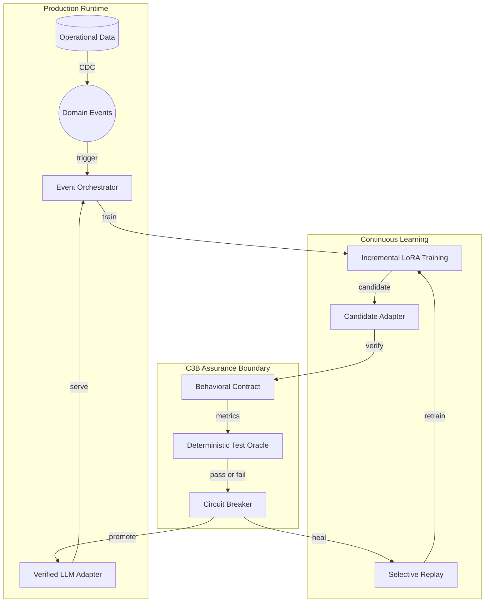
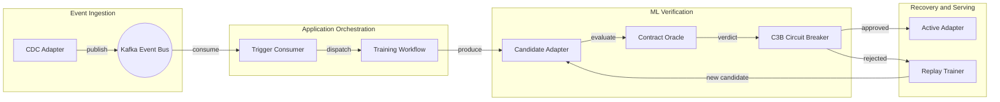

# Architecture Diagram

INTUNE is an event-driven software architecture for continuous LLM adaptation. C3B is the reliability boundary: it verifies every candidate adapter before deployment and automatically routes failed candidates to replay-based healing.

## Application Architecture

<!-- mermaid-checked: no \n, no em-dash/en-dash, no {} in labels, subgraphs are id["label"], arrows are -->|"label"|, all subgraphs closed by end, ids unique -->

### Architecture Keywords for SE for AI

| Concern | Architectural mechanism |
|---|---|
| Event-driven execution | CDC events, Kafka topics, consumer groups |
| ML change management | Candidate adapter and controlled promotion |
| Software contract | Safety, retention, and runtime SLAs |
| Reliability pattern | C3B circuit breaker with closed, open, and half-open states |
| Verification | Deterministic nine-metric oracle and pinned canary |
| Self-healing | Selective experience replay and candidate retraining |
| Reproducibility | Idempotent processing, manual offsets, audit evidence |

### Key Architectural Decisions

- Separates **runtime serving** from **candidate learning**, so unverified model changes cannot affect production traffic.
- Uses **events instead of polling** to make training orchestration reactive, observable, and independently scalable.
- Applies a **software reliability pattern to ML artifacts**: C3B blocks regressions, preserves the last verified adapter, and triggers recovery.

## Component Relationships

<!-- mermaid-checked: no \n, no em-dash/en-dash, no {} in labels, subgraphs are id["label"], arrows are -->|"label"|, all subgraphs closed by end, ids unique -->

### Component Inventory

| Component | Architectural role | SE for AI responsibility |
|---|---|---|
| CDC Adapter | Event source adapter | Converts data changes into versioned domain events |
| Kafka Event Bus | Integration backbone | Provides durable delivery and consumer-group isolation |
| Trigger Consumer | Application boundary | Provides idempotent, manually committed trigger handling |
| Training Workflow | ML orchestration service | Coordinates data preparation, training, and evaluation |
| Candidate Adapter | Versioned ML artifact | Represents a model change before release |
| Contract Oracle | Verification service | Measures safety, regression, grounding, and runtime behavior |
| C3B Circuit Breaker | Reliability controller | Allows, blocks, or re-tests adapter promotion |
| Replay Trainer | Self-healing service | Repairs backward degradation using historical examples |
| Active Adapter | Production artifact | Receives traffic only after contract approval |
