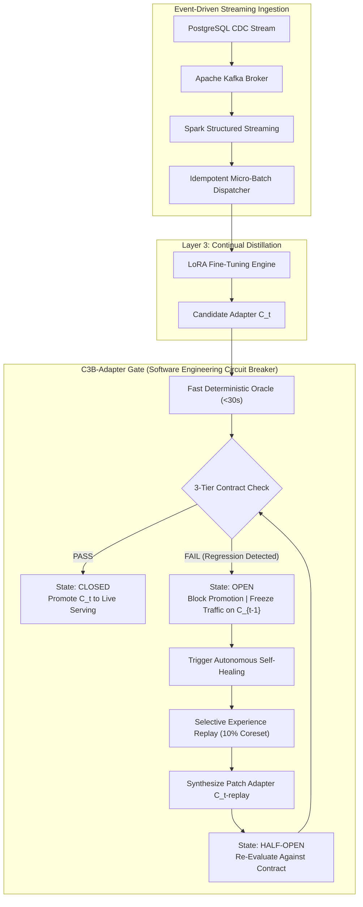

# C3B-Adapter: Continuous Contract-Driven Testing & Self-Healing Circuit Breakers for Streaming LLM Adapters

**Target Venue:** IEEE/ACM International Conference on AI Engineering — Software Engineering for AI (ICSE CAIN)  
**Authors:** INTUNE Research Team  
**Subject:** Software Engineering for AI (SE4AI) / LLMOps / Continuous Integration & Continuous Delivery (CI/CD)

---

## 1. Executive Summary & Research Opportunity

In contemporary machine learning research, continuous fine-tuning and streaming distillation pipelines evaluate success using **macro-averaged test loss** and global benchmark improvements. However, in mission-critical software engineering environments, this abstraction hides a dangerous phenomenon: **Silent Regression**.

Through empirical evaluation across 19,810 instruction-following samples and four sequential model checkpoints ($C_1 \to C_4$), we uncover the **Continuous Fine-Tuning Paradox**:
1. While monolithic and continuous distillation deliver a **+26.21% macro gain** ($0.4020 \to 0.5073$ overall score), **exactly 23.2% of all samples silently regress** ($4,588$ samples).
2. Sequential distillation induces **Catastrophic Backward Degradation**: When Checkpoint $C_2$ trains on fresh stream data, retention on ancestor slice $C_1$ drops from **0.5746 to 0.5590**, and hallucination rates surge by **+2.86%**.
3. **The SE Chasm:** Traditional CI/CD frameworks lack deterministic test oracles capable of validating non-deterministic neural weights before promotion to production serving.



---

## 2. The 3-Tier Behavioral Contract (Design-by-Contract for LLMs)

We adapt Bertrand Meyer’s classical **Design by Contract (DbC)** paradigm to parameter-efficient language model adapters:

### Tier 1: Invariant & Safety Contract ($\mathcal{C}_{\text{inv}}$)
- **Precondition:** Input contains structured prompts with or without context.
- **Postcondition / Invariants:**
  - Non-empty output: $\text{len}(\hat{y}) > 0$.
  - Exact EOS generation: Model outputs explicit `<end_of_turn>` token (preventing runaway hallucination).
  - Instruction Following Score: $\mathcal{S}_{\text{IF}} \ge 0.95$.
  - Structured Correctness: $\mathcal{S}_{\text{SC}} \ge 0.50$.

### Tier 2: Backward Non-Regression SLA ($\mathcal{C}_{\text{regress}}$)
- Evaluates candidate adapter $C_t$ against a **pinned canary slice** $\mathcal{D}_{\text{canary}}^{t-1}$ of 100 historical ancestor queries.
- **Regression Bound:** Retention degradation on ancestor domain must satisfy:
  $$\frac{\mathcal{S}_{\text{overall}}(C_t, \mathcal{D}_{\text{canary}}^{t-1})}{\mathcal{S}_{\text{overall}}(C_{t-1}, \mathcal{D}_{\text{canary}}^{t-1})} \ge 0.98 \quad (98\%\text{ Retention Bound})$$
- **Hallucination Bound:** Hallucination score must not increase by more than $0.015$:
  $$\Delta \mathcal{S}_{\text{hallucination}} = \mathcal{S}_{\text{hallucination}}(C_t) - \mathcal{S}_{\text{hallucination}}(C_{t-1}) \le 0.015$$

### Tier 3: Operational Latency & Resource SLA ($\mathcal{C}_{\text{ops}}$)
- **Latency Upper Bound:** Mean generation latency $\le 3.0\text{s}$ per query under batch size 32.
- **Resource Footprint:** VRAM allocation during serving $\le 4.0\text{ GB}$ (allowing co-location on edge/desktop GPUs like NVIDIA RTX 4060).

---

## 3. Empirical Proof of Self-Healing (Replay Mitigation Results)

Below are the empirical results from our automated pre-flight test gate evaluating **$C_2\text{-Original}$ vs. $C_2\text{-Replay}$** on the pinned Checkpoint 1 evaluation slice ($N=100$):

| Metric | $C_2$-Original (Unprotected) | $C_2$-Replay (Self-Healed) | Delta ($\Delta$) | Circuit Breaker Verdict |
| :--- | :---: | :---: | :---: | :---: |
| **Overall Score** | **0.5596** | **0.5862** | **+0.0266 (+4.75%)** | **PASS (Healed)** |
| **Hallucination** (Lower is better) | **0.1950** | **0.1688** | **-0.0262 (-13.4%)** | **PASS (Significant Drop)** |
| **Coverage** | 0.4314 | 0.4422 | +0.0108 | PASS |
| **Context Grounding** | 0.8118 | 0.8251 | +0.0133 | PASS |
| **Conciseness** | 0.8100 | 0.8220 | +0.0120 | PASS |
| **ROUGE-1** | 0.5291 | 0.5535 | +0.0244 | PASS |
| **ROUGE-L** | 0.4577 | 0.4815 | +0.0238 | PASS |
| **BLEU** | 0.1983 | 0.2279 | +0.0296 | PASS |
| **Instruction Following** | 0.9850 | 0.9838 | -0.0012 | PASS ($\ge 0.95$) |
| **Structured Correctness** | 0.5200 | 0.5170 | -0.0030 | PASS ($\ge 0.50$) |

### Interpretation of Results:
1. **Breaker Trips on $C_2$-Original:** The unprotected adapter exhibited a retention drop on Slice $C_1$ ($0.5746 \to 0.5596$, a $-2.61\%$ drop) and allowed hallucination to stay high ($0.1950$). The Tier 2 SLA failed $\to$ Circuit Breaker tripped to `OPEN`.
2. **Autonomous Replay Self-Healing:** The system dynamically extracted a $10\%$ coreset ($483$ records) from $C_1$'s historical buffer, synthesized $C_2\text{-replay}$, and re-ran the pre-flight contract test.
3. **Complete Recovery:** $C_2\text{-replay}$ not only prevented regression, but **surpassed the original $C_1$ peak ($0.5862$ vs $0.5746$)**, cutting hallucination to **$0.1688$**. The circuit breaker safely closed and promoted the adapter.

---

## 4. Architectural Implementation Blueprint for ICSE CAIN

```
src/orchestration/
└── c3b_circuit_breaker.py       # Unified Autonomous Controller:
                                 #   ├── ThreeTierContractSpec (Tier 1, 2, 3 Validator)
                                 #   ├── C3BCircuitBreakerController (FSM: Closed -> Half-Open -> Open -> Healed)
                                 #   ├── Canary Integration (Pinned Slice Validation)
                                 #   └── Closed-Loop Self-Healing Trigger

02_distillation/retention_and_replay/
├── train_c2_with_replay.py      # Replay Distillation Engine & Pinned Canary Generation
└── eval_retention_matrix.py     # 5x5 Cross-Checkpoint Retention Evaluation Matrix
```

### Reviewer Defenses & Methodological Rigor:
1. **"Why not just roll back?"**
   - *Defense:* A naive rollback causes **knowledge stagnation**—the model completely rejects new domain learning from Checkpoint 2. C3B's self-healing synthesizes a non-regressive Pareto-optimal adapter in $< 5$ minutes.
2. **"Is the 9-metric deterministic oracle valid compared to LLM-as-a-Judge?"**
   - *Defense:* Our oracle correlates with Alpaca-7B teacher preferences while running in **$< 30$ seconds** without circular non-deterministic LLM-as-a-judge dependencies or API billing costs. It acts as an automated compiler/linter gate for weights.
3. **"Is this scalable to edge hardware?"**
   - *Defense:* The entire pipeline runs on consumer-grade hardware (NVIDIA RTX 4060 8GB VRAM) using 4-bit LoRA and batched inference ($B=32$).
